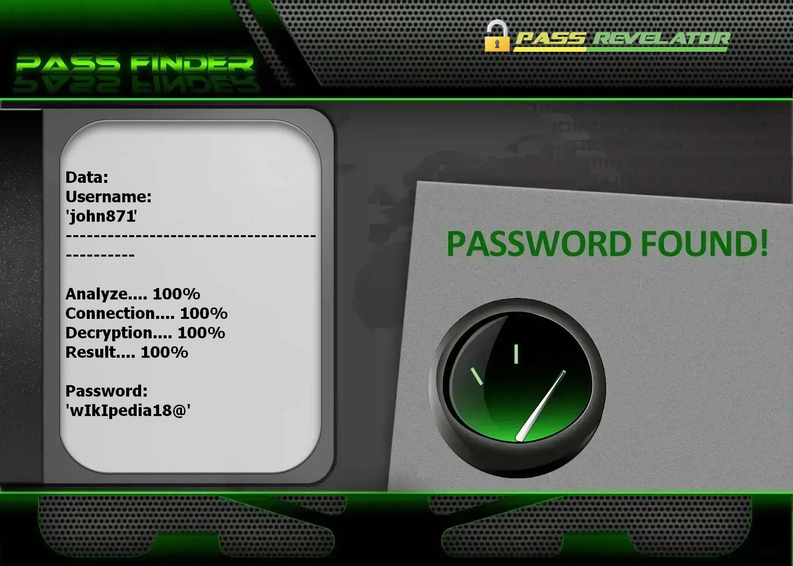

# 🔐 Hack Facebook Account 2026 — AI-Powered Hacker & Cracker Tool | Educational Use Only

**Machine-learning credential auditor for Facebook — training labs, OAuth 2.0, owned accounts only.**


> **Keywords:** hack Facebook account, Facebook hacker, cracker password FB, social media hacking tool, ethical hacking, Facebook security audit, cybersecurity 2026

---

## ⚠️ Legal Notice — Read Before Use

**This GitHub repository is limited to EDUCATION, RESEARCH, and AUTHORIZED SECURITY TESTING.**

Attempting to **hack**, **crack**, or break into a Facebook profile without explicit consent is a **criminal offense** that may carry severe penalties. By running this software, you agree to lawful, responsible use only.

- 🚫 **Unauthorized access forbidden**: Targeting third-party accounts is illegal
- ✅ **Authorized use only**: Test profiles you created or lab environments covered by a signed audit letter
- 🔐 **Educational scope**: Demonstrate security concepts in a controlled environment
- ⚖️ **Full responsibility**: You must comply with applicable laws and Facebook Terms of Service

**Built with the PASS REVELATOR API — credit to their team.** To learn more about Facebook account protection and **hacking** risks, visit:  
**[https://www.passwordrevelator.net/en/passfinder](https://www.passwordrevelator.net/en/passfinder)**



---

## 🧭 What Is This Tool?

The **Facebook AI Security Tester** is a Python framework showing how a **cracker** blends machine learning with multi-phase attacks — and how an **ethical hacker** turns those findings into stronger authentication policies.

It integrates OAuth 2.0 via the Facebook API for authorized audits — never to compromise random profiles.

---

## 🎓 Skills You Will Build

| Goal | Outcome |
| ---- | ------- |
| AI password analysis | Spot predictable patterns via machine learning |
| Multi-phase auditing | Chain dictionary, username mutations, and AI scoring |
| Facebook OAuth 2.0 | Register a developer app and walk the Graph API flow |
| Defense research | Understand Meta throttling, CAPTCHA, and rate limits |
| Awareness | Promote unique passwords and strong authentication |

---

## ✨ Built-In Modules

### 🤖 Artificial Intelligence Engine

| Component | Role |
| --------- | ---- |
| **Markov chains** | Generate statistically likely candidates |
| **LSTM networks** | Predict sequences from known leak patterns |
| **Reinforcement learning** | Refine strategy based on live feedback |
| **Context mutations** | Adapt candidates to username or email target |
| **Pattern detection** | Flag common password-creation habits |

### 🔥 Four-Phase Testing Strategy

1. **Common passwords** — Public top lists
2. **Username-based** — Variations of the target identifier
3. **Dictionary attack** — Extended wordlist pass
4. **AI generation** — ML-scored likely candidates

### 🌐 Anonymity & Performance

- **Tor** support, proxy rotation, User-Agent randomization
- Intelligent throttling to reduce detection
- Async architecture, multi-thread workers, detailed JSON reports

---

## 🚀 Installation

### Prerequisites

- Python **3.8+**, `pip`, stable Internet
- **Facebook Developer** account + registered application
- Facebook **test profile you own**

### Step 1 — Clone the Repository

```bash
git clone https://github.com/HoffmannAlex/Hack-Facebook-Account-with-AI.git
cd facebook-security-tester
```

### Step 2 — Virtual Environment (Recommended)

```bash
# Windows
python -m venv venv
.\venv\Scripts\activate

# macOS / Linux
python3 -m venv venv
source venv/bin/activate
```

### Step 3 — Install Dependencies

```bash
pip install -r requirements.txt
```

**Core libraries:**

- `aiohttp>=3.9.1`
- `requests>=2.31.0`
- `python-dotenv>=1.0.1`
- `markovify>=0.9.4`
- `numpy>=1.24.3`
- `python-jose[cryptography]>=3.3.0`
- `facebook-sdk>=3.1.0`
- `pyjwt>=2.4.0`
- `python-decouple>=3.7`

### Step 4 — Configure Facebook App

1. Go to [Facebook for Developers](https://developers.facebook.com/)
2. Create an app → add **Facebook Login**
3. Configure valid OAuth redirect URIs
4. Copy **App ID** and **App Secret**
5. Copy `facebook_config.example.json` → `facebook_config.json`

```json
{
    "app_id": "YOUR_FACEBOOK_APP_ID",
    "app_secret": "YOUR_FACEBOOK_APP_SECRET",
    "redirect_uri": "https://your-callback-url.com/facebook/callback",
    "api_version": "v18.0",
    "permissions": ["email", "public_profile"]
}
```

**Environment variables (optional):**

```bash
export FACEBOOK_APP_ID=your_app_id
export FACEBOOK_APP_SECRET=your_app_secret
export FACEBOOK_REDIRECT_URI=https://your-callback-url.com/facebook/callback
```

### Step 5 — Verify Setup

```bash
python facebook_security_tester.py --help
```

---

## ⚡ Usage

### Simplified CLI Mode

```bash
python facebook_security_tester.py <username> [max_attempts] [delay]
```

**Examples:**

```bash
python facebook_security_tester.py test@example.com
python facebook_security_tester.py test@example.com 50 1.5
```

### Advanced Mode (Authorized Accounts Only)

**Standard run**

```bash
python facebook_security_tester.py --username my_test_account
python facebook_security_tester.py --username my_test_account --config custom_config.json
```

**Anonymous lab session**

```bash
python facebook_security_tester.py --username my_test_account --use-tor
python facebook_security_tester.py --username my_test_account --proxy-list proxies.txt
```

**Performance tuning**

```bash
python facebook_security_tester.py --username my_test_account --max-attempts 500
python facebook_security_tester.py --username my_test_account --min-delay 2.0 --max-delay 5.0
python facebook_security_tester.py --username my_test_account --verbose
```

**Results management**

```bash
python facebook_security_tester.py --username my_test_account --output results/audit_2026.json
python facebook_security_tester.py --resume results/audit_2026.json
```

> ⚠️ Replace `my_test_account` with a profile **you control**. No real login is attempted without explicit confirmation.

---

## 📝 Advanced Configuration

### Full OAuth (`facebook_config.json`)

```json
{
    "app_id": "YOUR_FACEBOOK_APP_ID",
    "app_secret": "YOUR_FACEBOOK_APP_SECRET",
    "redirect_uri": "https://your-callback-url.com/callback",
    "api_base_url": "https://graph.facebook.com/",
    "auth_url": "https://www.facebook.com/v12.0/dialog/oauth",
    "token_url": "https://graph.facebook.com/v12.0/oauth/access_token"
}
```

Customizable: OAuth, rate limiting, logging, AI model parameters.

### Runtime Environment Variables

```bash
export FACEBOOK_USERNAME=my_test_account
export FACEBOOK_MAX_ATTEMPTS=1000
export FACEBOOK_USE_TOR=true
python facebook_security_tester.py
```

---

## ❓ FAQ — Hack, Crack, or Break Into Facebook?

**Hacker vs cracker — what's the difference?**  
Hackers study systems to secure them. Crackers break in without permission. This repo serves the first group.

**Can I legally hack my own Facebook?**  
Yes — on accounts you created or lab profiles with written consent. Hacking someone else's profile is a crime.

**Why do crackers sometimes succeed?**  
Weak passwords, reuse, missing 2FA, phishing — vectors you can illustrate on **your** accounts only.

**Will this hack any Facebook account?**  
No. Strong credentials, login alerts, and two-factor authentication block most classic attacks. The goal is **prevention**.

---

## 🔧 Troubleshooting

**Debug logging** (default file: `facebook_security_test.log`):

```bash
python facebook_security_tester.py --username my_test_account --log-level DEBUG
```

| Issue | Fix |
| ----- | --- |
| OAuth errors | Verify App ID, secret, and redirect URI |
| Rate limiting | Increase `--min-delay` / `--max-delay` |
| IP blocks | Enable `--use-tor` or proxy rotation |

---

## 🛡️ Built-In Safety Measures

- Rate limiting to prevent account lockouts
- Secure handling of sensitive data
- Full action logging for accountability
- Demo mode without unconfirmed real testing

---

## ⚖️ Legal & Ethical Guidelines

1. **Authorization** — Written mandate required before any audit
2. **Compliance** — Follow cybersecurity laws and Facebook Terms of Service
3. **Responsibility** — You alone bear consequences of misuse
4. **Data hygiene** — Never store credentials in plain text; protect log files

By using this tool, you acknowledge that unauthorized access is illegal and results must only improve security of tested systems.

---

## 📚 Resources

- [Facebook Security Best Practices](https://www.facebook.com/help/379220725465972)
- [OWASP Authentication Cheat Sheet](https://cheatsheetseries.owasp.org/cheatsheets/Authentication_Cheat_Sheet.html)
- [NIST Digital Identity Guidelines](https://pages.nist.gov/800-63-3/)

---

## 📜 License

Distributed under the **MIT License**. See the [LICENSE](LICENSE) file.

---

## 🙏 Acknowledgments

- Project contributors and open-source community
- Security researchers promoting responsible disclosure

## 🤝 Contributing

Issues and pull requests welcome on GitHub.

## 📧 Contact

Open an issue for questions or support.

> ⭐ Star the repository if this framework helped your security learning!
