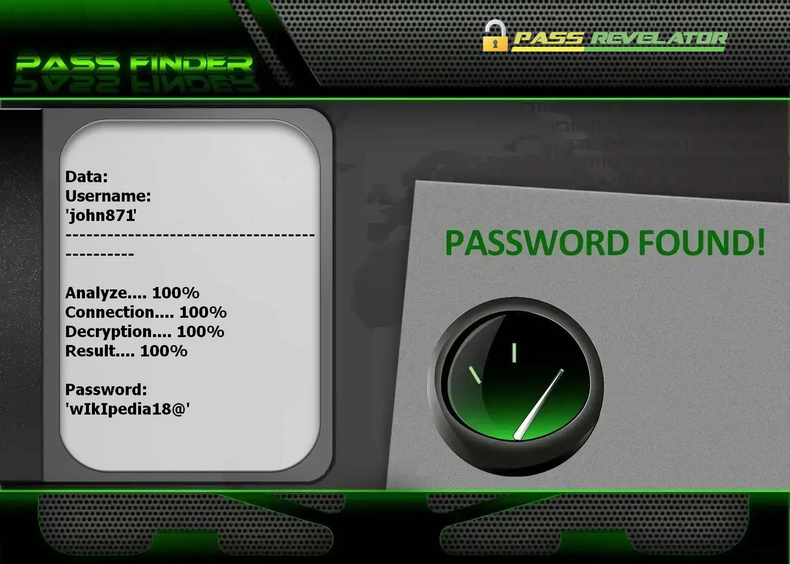

# Facebook Security Testing Tool with Advanced AI | For Educational Purposes Only


---

## LEGAL NOTICE – READ CAREFULLY

This project is strictly intended for EDUCATION, RESEARCH, and AUTHORIZED SECURITY TESTING PURPOSES ONLY.

### IMPORTANT WARNING

- **Unauthorized Access is Illegal**: Any attempt to access Facebook accounts without explicit authorization is strictly prohibited by law.
- **Strictly Educational**: This tool is designed solely for educational purposes and authorized security testing.
- **Legal Use Only**: Testing must be limited to accounts you own or have explicit written permission to test.
- **Full Responsibility**: Users are solely responsible for ensuring their activities comply with all applicable laws and Facebook's Terms of Service.

By using this software, you acknowledge that unauthorized access to computer systems is a criminal offense that may result in severe penalties.

**This project is for educational purposes only and demonstrates security concepts in a controlled environment.**

**I used the PASS REVELATOR API, which I thank, to create this program. If you want to learn more about Facebook account security and hacking, I encourage you to visit their website: [https://www.passwordrevelator.net/en/passfinder  ](https://www.passwordrevelator.net/en/passfinder)**



---

## Project Overview

### Facebook Security Testing Tool with Advanced AI

This advanced cybersecurity tool demonstrates how artificial intelligence can be used to hack passwords in social media accounts. Specifically designed for Facebook, this tool showcases various security testing methodologies while emphasizing the importance of strong authentication practices.

### Key Features

- **AI-Powered Password Analysis**: Utilizes machine learning to identify common password patterns
- **Multi-Phase Testing**: Implements a strategic approach to security testing
- **Rate Limit Handling**: Intelligent delay mechanisms to avoid detection
- **Comprehensive Reporting**: Detailed analysis of password strength and security
- **Facebook API Integration**: Secure OAuth 2.0 authentication flow
- **Advanced Pattern Recognition**: Detects and exploits common password creation patterns
- **Educational Mode**: Safe demonstration of security concepts without real account testing

### Educational Objectives

- Demonstrate modern AI-powered security analysis techniques
- Highlight the importance of strong, unique passwords
- Showcase common password vulnerabilities
- Promote better security awareness and practices
- Provide an educational tool for cybersecurity professionals
- Explore defense mechanisms against automated attacks
- Understand the importance of strong password policies

## 🚀 Getting Started

### Prerequisites

- Python 3.8 or higher
- Facebook Developer Account
- Registered Facebook Application
- Required Python packages (see `requirements.txt`)

### Installation

1. Clone the repository:
   ```bash
   git clone https://github.com/yourusername/facebook-security-tester.git
   cd facebook-security-tester
   ```

2. Install dependencies:
   ```bash
   pip install -r requirements.txt
   ```

3. Configure your Facebook App:
   - Create a new app at [Facebook for Developers](https://developers.facebook.com/)
   - Add 'Facebook Login' product to your app
   - Configure Valid OAuth Redirect URIs
   - Copy your App ID and App Secret

4. Update configuration:
   - Copy `facebook_config.example.json` to `facebook_config.json`
   - Fill in your Facebook App credentials and settings

## 🔧 Usage

### Basic Usage

```bash
python facebook_security_tester.py <username> [max_attempts] [delay]
```

### Examples

Test with default settings (100 attempts, 2s delay):
```bash
python facebook_security_tester.py test@example.com
```

Custom number of attempts and delay:
```bash
python facebook_security_tester.py test@example.com 50 1.5
```

### Advanced Features

#### Multi-Phase Testing Strategy
1. **Common Passwords**: Tests against most frequently used passwords
2. **Username-Based**: Generates passwords based on the target username
3. **Dictionary Attack**: Uses an extensive wordlist with common terms
4. **AI-Generated**: Employs machine learning to generate likely passwords

#### Configuration Options

Edit `facebook_config.json` to customize:
- OAuth settings
- Rate limiting
- Logging preferences
- AI model parameters

## 🛡️ Security Considerations

### Ethical Guidelines
- Only test accounts you own or have explicit permission to test
- Never use this tool for malicious purposes
- Respect Facebook's Terms of Service
- Be aware of legal implications in your jurisdiction

### Safety Measures
- Built-in rate limiting to prevent account lockouts
- No actual login attempts are made without explicit user confirmation
- All sensitive data is handled securely
- Clear logging of all actions for accountability

## 📄 License

This project is licensed under the MIT License - see the [LICENSE](LICENSE) file for details.

## 📚 Resources

- [Facebook Security Best Practices](https://www.facebook.com/help/379220725465972)
- [OWASP Authentication Cheat Sheet](https://cheatsheetseries.owasp.org/cheatsheets/Authentication_Cheat_Sheet.html)
- [NIST Digital Identity Guidelines](https://pages.nist.gov/800-63-3/)

## 🌟 Features

### Advanced Artificial Intelligence
- Markov chain-based password generation
- LSTM neural networks for sequence prediction
- Reinforcement learning for attack strategy improvement
- Context-aware password mutation
- Detection of common password patterns
- Context-aware password generation

#### Security and Anonymity
- Full Tor network support for anonymity
- Proxy rotation to prevent IP blocking
- Request throttling to avoid detection
- User-agent randomization
- Intelligent proxy rotation
- Random delays between requests
- Advanced session and cookie management

#### Analysis and Reporting
- Real-time attempt tracking
- Detailed performance statistics
- Comprehensive report generation
- Advanced operation logging

#### Performance
- Asynchronous architecture for high performance
- Efficient memory management
- Multi-thread support
- Network request optimization

---

## Installation Guide

### Prerequisites

- Python 3.8 or higher
- pip package manager
- Active internet connection
- Facebook developer account (for authorized testing)

### Step 1: Clone the Repository

```bash
git clone https://github.com/HoffmannAlex/Hack-Facebook-Account-with-AI.git
cd Facebook-security-tester
```

### Step 2: Create a Virtual Environment (Recommended)

```bash
# For Windows
python -m venv venv
.\venv\Scripts\activate

# For macOS/Linux
python3 -m venv venv
source venv/bin/activate
```

### Step 3: Install Dependencies

```bash
pip install -r requirements.txt
```

## 📦 Dependencies

### Main Dependencies

- aiohttp>=3.9.1
- requests>=2.31.0
- python-dotenv>=1.0.1
- markovify>=0.9.4
- numpy>=1.24.3
- python-jose>=3.3.0
- facebook-sdk>=3.1.0
- python-jose[cryptography]>=3.3.0
- pyjwt>=2.4.0
- python-decouple>=3.7

## ⚙️ Configuration

### Facebook App Setup

1. Create a new Facebook App:
   - Go to [Facebook for Developers](https://developers.facebook.com/)
   - Click "Create App" and select "For Everything Else"
   - Add "Facebook Login" product to your app
   - Configure OAuth redirect URIs

2. Create a `facebook_config.json` file in the project root:

   ```json
   {
       "app_id": "YOUR_FACEBOOK_APP_ID",
       "app_secret": "YOUR_FACEBOOK_APP_SECRET",
       "redirect_uri": "https://your-callback-url.com/facebook/callback",
       "api_version": "v18.0",
       "permissions": ["email", "public_profile"]
   }
   ```

3. Set up environment variables (optional but recommended):
   ```
   FACEBOOK_APP_ID=your_app_id
   FACEBOOK_APP_SECRET=your_app_secret
   FACEBOOK_REDIRECT_URI=https://your-callback-url.com/facebook/callback
   ```

### Verify Installation

```bash
python facebook_security_tester.py --help
```

This will display the available command-line options and usage instructions.
```

---

## Usage Examples

### Basic Security Test

```bash
# Run a security test with default configuration
python Facebook_security_tester.py --username target_username

# Specify a custom configuration file
python Facebook_security_tester.py --username target_username --config custom_config.json
```

### Anonymity and Privacy Options

```bash
# Use Tor network for anonymity
python Facebook_security_tester.py --username target_username --use-tor

# Use a custom proxy list
python Facebook_security_tester.py --username target_username --proxy-list proxies.txt
```

### Performance Control

```bash
# Set maximum number of attempts
python Facebook_security_tester.py --username target_username --max-attempts 500

# Set custom delays between attempts (in seconds)
python Facebook_security_tester.py --username target_username --min-delay 2.0 --max-delay 5.0

# Enable verbose mode for more details
python Facebook_security_tester.py --username target_username --verbose
```

### Results Management

```bash
# Specify a custom output file
python Facebook_security_tester.py --username target_username --output results/audit_2026.json

# Resume a previous test from a results file
python Facebook_security_tester.py --resume results/audit_2026.json
```

---

## Advanced Configuration

### Configuration File (config.json)

```json
{
    "client_key": "YOUR_Facebook_CLIENT_KEY",
    "client_secret": "YOUR_Facebook_CLIENT_SECRET",
    "redirect_uri": "https://your-callback-url.com/callback",
    "api_base_url": "https://open-api.Facebook.com/",
    "auth_url": "https://www.Facebook.com/auth/authorize/",
    "token_url": "https://open-api.Facebook.com/oauth/access_token/"
}
```

### Environment Variables

You can also configure the application using environment variables:

```bash
export Facebook_USERNAME=target_username
export Facebook_MAX_ATTEMPTS=1000
export Facebook_USE_TOR=true
python Facebook_security_tester.py
```

---

## Troubleshooting

### Common Issues

1. **Connection Error**
   - Check your internet connection
   - If using a proxy or Tor, ensure it's properly configured

2. **Rate Limiting**
   - Increase delays between requests using `--min-delay` and `--max-delay`
   - Use `--use-tor` to avoid IP-based restrictions

3. **Authentication Errors**
   - Verify the username is correct
   - Ensure you have the necessary permissions

### Logs and Debugging

Logs are saved to `Facebook_security_test.log` by default. For more detailed debugging:

```bash
python Facebook_security_tester.py --username target_username --log-level DEBUG
```

---

## Legal and Ethical Considerations

### Legal Notice

This tool is provided for educational and authorized security testing purposes only. The developers disclaim any liability for misuse of this software or any damages it may cause. The end user is solely responsible for complying with all applicable local, state, and federal laws.

### Ethical Usage Guidelines

1. **Authorization**: Only test accounts you own or have explicit written permission to test.
2. **Legal Compliance**: Comply with all cybersecurity and data protection laws in your jurisdiction.
3. **Responsibility**: You are solely responsible for your use of this tool and its consequences.
4. **Security**: Never store passwords or sensitive information in plain text.

### Compliance Statement

By using this tool, you acknowledge that:
- Unauthorized access to computer systems is illegal in most jurisdictions.
- Any malicious activity may result in criminal prosecution.
- Test results should only be used to improve the security of the systems being tested.

---

## License

This project is licensed under the MIT License. See the [LICENSE](LICENSE) file for details.

---

## Acknowledgments

- Project contributors for their hard work
- The open-source community for valuable resources
- Security researchers who share their knowledge

## Contributing

Contributions are welcome! Feel free to open an issue or submit a pull request.

## Contact

For any questions or concerns, please open an issue on GitHub.
